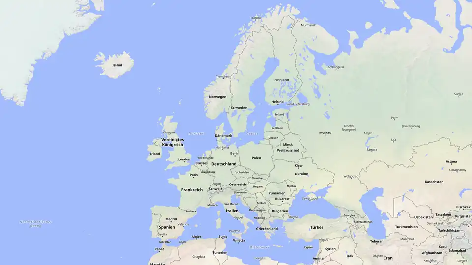

# Map Render Tool

Browser tool for animated map flights — zoom from country to region, highlight areas, draw routes, pin markers — exported frame by frame as MP4 or image sequence for video editing.



> [!NOTE]
> **Personal proof of concept, not a maintained product.** Built for my own video editing: German UI, defaults tuned for Germany/Europe, single user. It relies on free public map services that are not meant for heavy traffic (see [Limitations](#limitations--security)). Feel free to run it locally or fork it — no support, no guarantees.

## Features

- **Camera flight** across any number of waypoints, with zoom, hold and travel times
- **Markers** with name labels and a pulse effect
- **Areas** (administrative boundaries, national parks, nature reserves) from OpenStreetMap, picked with a right-click
- **Routes**, as many as needed, each via street routing (OSRM) or straight lines in its own color — drawn progressively, chainable end to end
- **Timeline** to set when each object appears
- **Deterministic export:** every frame is rendered from the project state, so the video matches the preview exactly — MP4 (H.264, WebCodecs) or PNG/JPEG sequence; landscape, portrait and square formats up to 4K, 24–60 fps
- **Local area database:** a background worker slowly builds a local copy of area boundaries, so lookups don't depend on the public Overpass API being available

## Quick start

Requires Docker with Compose.

```sh
git clone https://github.com/craBshot/map-render-tool.git
cd map-render-tool
docker compose up -d --build
```

Open <http://localhost:8080>. Right-click the map to place things; the mode buttons on the left switch between markers, areas, route and camera. `Ctrl+Z` / `Ctrl+Shift+Z` undo and redo.

**Keep the tab visible while exporting.** Browsers pause rendering in background tabs and minimized windows; the export then pauses too and resumes when you return. A visible window next to other apps is fine.

**MP4 export** needs a secure context (`localhost` or HTTPS). Over plain HTTP from another machine, use the image sequence export instead.

Stop with `docker compose down`. The area database lives in the `map-render-tool_area-db-data` volume and survives restarts (`down -v` deletes it).

## Development

```sh
npm install
npm run dev         # dev server (area lookups fall back to live Overpass)
npm test            # unit tests (Vitest)
npm run test:e2e    # end-to-end tests (Playwright, external services mocked)
```

Stack: TypeScript, React, Vite, MapLibre GL JS, Zustand; worker in plain Node.js without dependencies.

## How it was built

Concept, product decisions and testing by me; code written with [Claude Code](https://claude.com/claude-code) as an AI pair programmer. All features were built over four days (see the commit history). [`CLAUDE.md`](CLAUDE.md) holds the project brief and architecture decisions the AI works from.

## Limitations & security

- **Designed for local, single-user use.** No accounts or access control — anyone who can reach the port can use it. Put it behind a reverse proxy with authentication (and HTTPS) if you expose it beyond your own machine.
- **Public services with fair-use policies:** [OpenFreeMap](https://openfreemap.org) (tiles), [Nominatim](https://operations.osmfoundation.org/policies/nominatim/) (search), [Overpass API](https://overpass-api.de) (areas) and the [OSRM demo server](https://github.com/Project-OSRM/osrm-backend/wiki/Demo-server) (routing). They are fine for occasional personal use, but not for running this as a service for many users — that would require self-hosted instances.
- **The background worker** sends one query to the public Overpass API every 90 seconds while it runs.
- The nginx container serves plain HTTP without security headers; TLS is expected to come from a reverse proxy.

## Data & attribution

Map data © [OpenStreetMap](https://www.openstreetmap.org/copyright) contributors, available under the [ODbL](https://opendatacommons.org/licenses/odbl/). Map styles and tiles by [OpenFreeMap](https://openfreemap.org) / © [OpenMapTiles](https://openmaptiles.org). The attribution is drawn into every exported frame and must stay visible when you publish videos made with this tool.

Main dependencies: MapLibre GL JS (BSD-3-Clause), React, Zustand, mp4-muxer (MIT), JSZip (MIT or GPL-3.0).

## License

[MIT](LICENSE) © craBshot
